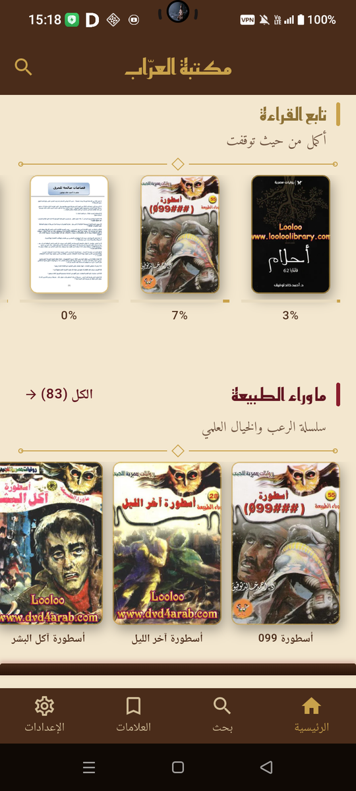
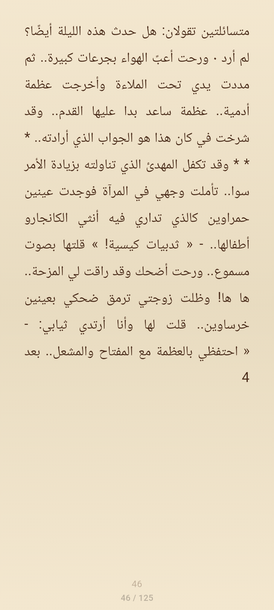
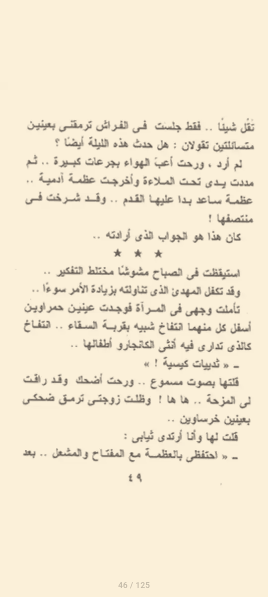
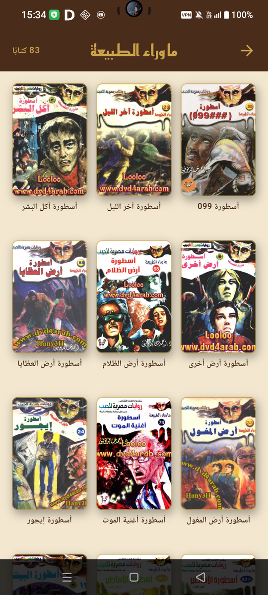
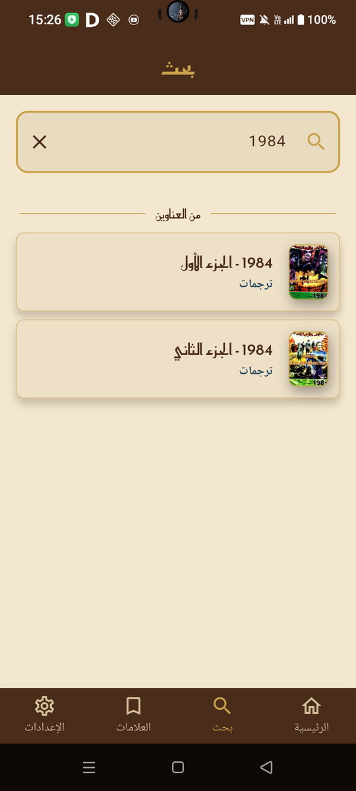
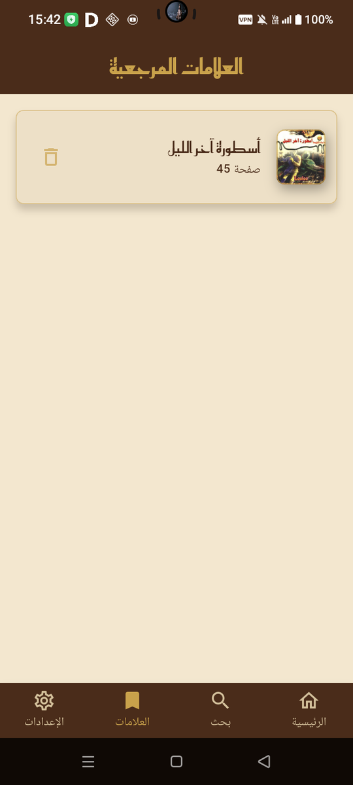

# مكتبة العرّاب — Maktabat Al-Arrab

<p align="center">
  
</p>

<p align="center">
  
  
  
  
  
  
</p>

<p align="center">
تطبيق قراءة عربي بواجهة من اليمين إلى اليسار، يعمل بلا إنترنت تمامًا،<br>
يحوي <strong>293</strong> عملًا للدكتور <strong>أحمد خالد توفيق</strong> في <strong>43,137</strong> صفحة ممسوحة.
</p>

---

## التحميل والتثبيت

| | |
| --- | --- |
| **أحدث إصدار** | [`v2.5.0`](../../releases/latest) |
| **الملف** | `Maktabat_Al_Arrab_v2.5.0.apk` |
| **الحجم** | نحو 876 م.ب — المكتبة كاملةً داخل الملف |
| **المتطلبات** | أندرويد 7.0 (API 24) أو أحدث · نحو 1.5 ج.ب مساحة حرة |

1. نزّل ملف الـ APK من صفحة الإصدارات.
2. اسمح بتثبيت التطبيقات من مصادر غير معروفة لمدير الملفات.
3. افتح الملف وثبّته.

لا حاجة إلى تنزيل أي شيء بعد التثبيت: المكتبة والأغلفة والنصوص كلها داخل الحزمة.

> **لماذا الملف كبير؟** لأن 43 ألف صفحة مصوّرة مضمّنة بداخله. لا يوجد أي اتصال بالشبكة
> عند التشغيل، ولا خطوة «تحميل المكتبة» أول مرة.

---

## لقطات

<p align="center">
  
  
  
</p>
<p align="center">
  
  
  
</p>

---

## المزايا

- **مكتبة كاملة بلا إنترنت.** لا صلاحية شبكة، لا تحميل، لا حساب.
- **قارئ بوضعين.** نصّي قابل للبحث والتغيير، أو صورة الصفحة الأصلية — والتبديل بينهما
  يُبقيك على الصفحة نفسها لا يعيدك إلى البداية.
- **بحث داخل الكتاب.** نتائج مرتّبة مع الانتقال إليها، ويعمل في خيط منفصل فلا تتجمّد
  الواجهة على الكتب الكبيرة.
- **بحث في المكتبة كلها** مع تطبيع الإملاء العربي: `أ إ آ ٱ ← ا`، `ة ← ه`، `ى ئ ← ي`،
  `ؤ ← و`، وحذف التشكيل والتطويل — فتجد الكلمة مهما كُتبت.
- **علامات مرجعية ثابتة.** تُحفظ بموضع الحرف لا برقم الصفحة، فلا تنكسر عند تغيير حجم
  الخط أو نوعه.
- **تتبّع القراءة** لكل كتاب مع نسب الإنجاز في «تابع القراءة».
- **قارئ غامر:** الصفحة تملأ الشاشة، والأشرطة تختفي وحدها، وأشرطة النظام تُخفى.
- **تكبير بالسحب** مع تعطيل تقليب الصفحات أثناء التكبير كي لا تتصادم الإيماءات.
- **ستة أقسام** بألوان مميّزة، وثيم «مكتبة عتيقة»: رَقّي، جِلدي، ذهبي، قرمزي.
- **ثلاثة خطوط عربية** (Amiri · Reem Kufi · Cairo) بستّة أوزان، وأحجام قابلة للضبط.

---

## المكتبة

| القسم | الكتب |
| --- | ---: |
| ما وراء الطبيعة | 83 |
| فانتازيا | 59 |
| سافاري | 51 |
| ترجمات وكتب غير روائية | 74 |
| روايات منفردة | 23 |
| مقالات وقصص قصيرة | 3 |
| **الإجمالي** | **293** |

### جودة النص

المصادر ملفات PDF ممسوحة بلا طبقة نصية، فاستُخرج النص بـ Tesseract ثم صُحّح بقواعد
عربية محلية (بلا خدمة سحابية وبلا نموذج لغوي خارجي).

| المؤشر | القيمة |
| --- | --- |
| كتب بنص كامل قابل للبحث | 287 من 293 |
| متوسط نسبة الصفحات المقبولة | 98.36 % |
| متوسط ثقة التعرّف | 84.9 |
| كتب بلغت 95 % أو أكثر | 275 |
| كتب بقيت بالصور فقط | 6 (تحت العتبة فعليًا) |

الكتب الستة الباقية بالصور فقط: `book_051` · `book_089` · `book_168` · `book_218` ·
`book_224` · `book_271` — مطبوعات رديئة أو صفحات كوميكس بلا نص أصلًا.
التفصيل في [`REPORT.md`](REPORT.md) و[`docs/ocr_report.md`](docs/ocr_report.md).

---

## البنية

```
maktabat_al_arrab/
├── lib/
│   ├── main.dart
│   ├── core/
│   │   ├── models/       book · bookmark · section · reader_settings · reading_progress
│   │   ├── services/     library_service · library_source · storage_service
│   │   │                 text_paginator · page_split_service · page_flip_service
│   │   ├── providers/    Riverpod
│   │   └── theme/        الثيم العتيق
│   ├── features/         splash · home · section · book_detail · reader
│   │                     bookmarks · settings · search · setup
│   └── widgets/          page_curl · page_transitions · common_widgets
├── scripts/              خط معالجة المحتوى (Python)
├── test/                 اختبارات Dart
├── docs/                 تقارير ولقطات
└── assets/               (المكتبة الثنائية غير مضمّنة في المستودع)
```

### التقنيات

| الطبقة | الاختيار |
| --- | --- |
| الواجهة | Flutter / Dart 3 |
| إدارة الحالة | Riverpod |
| التخزين المحلي | Hive |
| فكّ ضغط الصفحات | `archive` |
| معالجة الصور | PyMuPDF · Pillow · OpenCV |
| استخراج النص | Tesseract + مصحّح قواعدي عربي |

### قرارات تصميم تستحق الذكر

- **أسماء أصول ASCII إلزاميًا.** الأسماء العربية تُرمَّز percent-encoding داخل الـ APK
  فتفشل `rootBundle.load`؛ لذلك كل المعرّفات `book_NNN`.
- **`SizedBox.expand` حول `Image.file`.** `Center` وحده يترك الصورة بحجمها البكسلي
  بدل ملء عرض الشاشة.
- **`panEnabled` عند التكبير فقط** كي تصل السحبات الأفقية إلى `PageView`، مع تبديل
  الفيزياء إلى `NeverScrollableScrollPhysics` أثناء التكبير.
- **الكتب تُستخرج من ZIP مرة واحدة** إلى مجلد دعم التطبيق مع علامة `.extracted`،
  وتُنظَّف مجلدات الكتب الأخرى عند فتح كتاب جديد لكبح التخزين.
- **البحث في `Isolate`** عبر `Isolate.run` و`RootIsolateToken`، فلا تتجمّد الواجهة.

---

## التشغيل من المصدر

```bash
flutter pub get
dart run flutter_launcher_icons     # يولّد الأيقونة التكيّفية من assets/icon/
flutter build apk --release         # نحو 11 دقيقة
```

### المكتبة الثنائية ليست في المستودع

`assets/books/` و`assets/covers/` و`assets/book_jsons/` تبلغ نحو 870 م.ب، وهي ناتج
خط المعالجة لا مصدره. لتوليدها من ملفات PDF الأصلية:

```bash
pip install -r scripts/requirements.txt

python scripts/build_page_library.py --count 10   # صفحات WebP + أغلفة
python scripts/ocr_book.py --count 10             # نص + بوّابة جودة
python scripts/generate_manifest.py               # assets/library.json
python scripts/finalize_assets.py                 # تقليص + مزامنة المؤشرات
```

كل خطوة **قابلة للاستئناف** بـ `--count N`، وتتخطّى ما أُنجز فعلًا.

---

## الاختبارات

```bash
flutter analyze     # 0 خطأ · 0 تحذير
flutter test        # 4 ملفات اختبار
python -m pytest scripts/tests   # قواعد التطبيع العربي
```

---

## القيود المعروفة

1. **الحجم:** نحو 876 م.ب لأن الصفحات مضمّنة. تقليصه جوهريًا يعني خفض دقّة الصور أو
   إخراج المكتبة من الحزمة.
2. **الكتب الستة** بلا نص قابل للبحث.
3. **قلب الصفحات** حركة `PageView` لا تجعيدًا ثلاثي الأبعاد حقيقيًا.
4. **إعدادات الخط** تظهر في الورقة السريعة للكتب الممسوحة حيث لا أثر لها.

---

## الترخيص وحقوق النشر

كود التطبيق متاح للاطّلاع. **أعمال د. أحمد خالد توفيق محمية بحقوق نشر** ولا تُنشر
هنا؛ المكتبة الثنائية غير مضمّنة في المستودع، والتطبيق أداة قراءة شخصية لمكتبة يملكها
صاحبها وليست وسيلة توزيع.

<div align="center">
  <sub>صُنع بشغف للقراءة العربية</sub>
</div>
